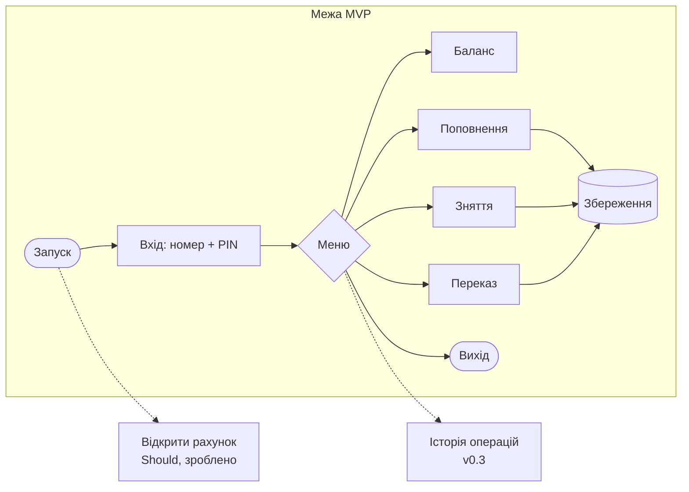

# MVP і пріоритети

## MoSCoW

| Must | Should | Could | Won't |
|---|---|---|---|
| FR-01 Вхід за номером і PIN | FR-07 Відкриття рахунку ✅ | FR-11 Зміна PIN | FR-13 Валюти |
| FR-02 Баланс | FR-08 3 спроби входу ✅ | FR-12 Закриття рахунку | FR-14 Мережа |
| FR-03 Поповнення | FR-09 Історія операцій | | |
| FR-04 Зняття | FR-10 Блокування після 3 спроб | | |
| FR-05 Переказ | | | |
| FR-06 Збереження між запусками | | | |
| FR-15 Некоректна сума не змінює баланс | | | |

**Перевірка Must «що буде без цього»:** без FR-01 будь-хто керує чужим рахунком; без FR-02…FR-05 немає банку; без FR-06 усі дані зникають після виходу — у v0.1.0 саме так і було (BUG-05), а задум автора — «записувати дані користувачів».

## Межа MVP

**MVP (v0.2.0) = FR-01…FR-06, FR-15.** Плюс NFR-1 (точні суми) і NFR-3 (ввід не вішає програму) — без них операції формально є, але працюють неправильно.

Чому межа саме тут: шлях «увійти → зробити операцію → вийти → повернутися й побачити ту саму суму» — мінімум, за який банку можна довіряти. Відкриття рахунку зручне, але без нього демо-рахунки вже дають пройти шлях.
