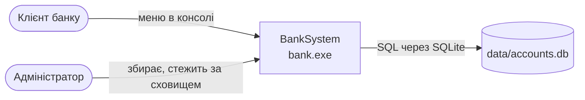
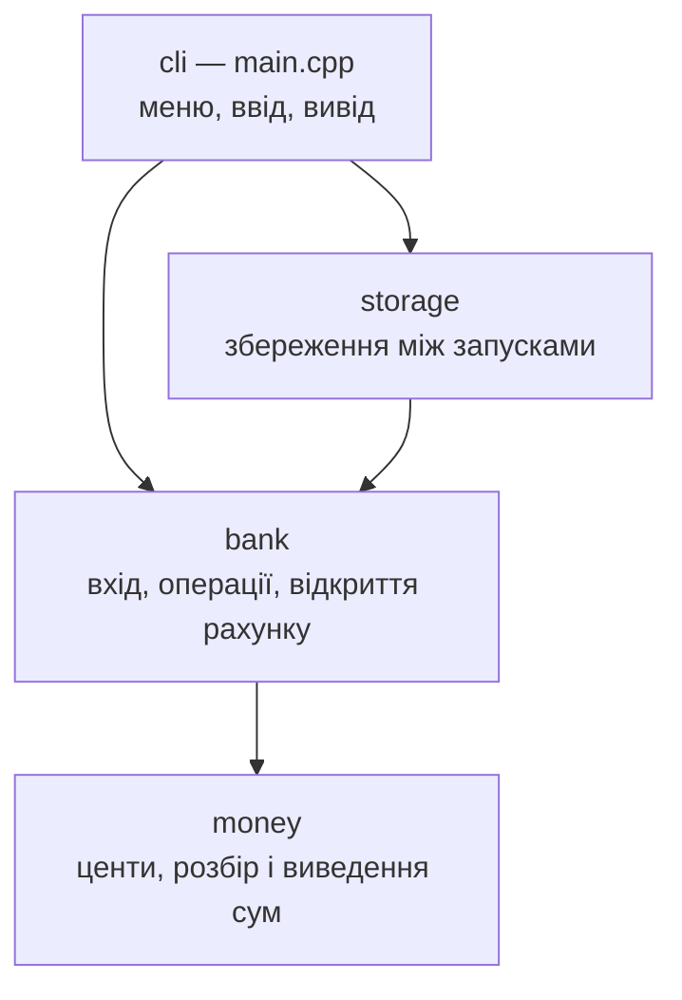

# Архітектура

> Автор: Юра Кампов, спеціальність F2 «Інженерія програмного забезпечення».

**Стиль: шарова консольна програма.** Діалог із користувачем (`cli`) → бізнес-логіка (`bank`, `money`) → збереження (`storage`). Логіка не знає ні про консоль, ні про файли — тому тестується окремо.

| Варіант | Чому ні / так |
|---|---|
| Усе в одному `main.cpp` (як у v0.1.0) | логіку не протестувати без консолі; будь-яка зміна зачіпає все |
| **Шари: cli → bank/money → storage** | ✅ кожен модуль має одну відповідальність і свої тести |
| Клієнт-сервер / сервер БД | надмірно для навчальної моделі з одним користувачем за раз; вбудована SQLite дає транзакції без сервера ([ADR-0004](adr/0004-sqlite-storage.md)) |

## Контекст

## Компоненти

Залежності йдуть в один бік: `cli` знає всіх, `bank` — лише `money`, `storage` — лише структуру рахунку. Жоден модуль, крім `cli`, не читає `std::cin` і не пише в `std::cout`.

## Ключові рішення

| Рішення | ADR |
|---|---|
| C++17 і CMake; єдина стороння бібліотека — вбудована SQLite | [ADR-0001](adr/0001-cpp-console.md) |
| Гроші — ціле число центів | [ADR-0002](adr/0002-money-in-cents.md) |
| Сховище — база SQLite, вихідний код у репозиторії (замінило текстовий файл ADR-0003) | [ADR-0004](adr/0004-sqlite-storage.md) |

## Нефункціональне в архітектурі

| Вимога | Як забезпечено |
|---|---|
| NFR-1 точні суми | `Money = int64_t` центів, строгий `parse_money` |
| NFR-2 надійність збереження | збереження — одна транзакція SQLite; обмеження в схемі; пошкоджене сховище не перезаписується |
| NFR-3 стійкість вводу | `cli` читає рядками; кінець вводу завершує програму |
| NFR-7 супроводжуваність | логіка без вводу-виводу, 33 модульні тести |

## Масштабування й розширення

| Що зміниться | Що робимо | Які модулі зачепить |
|---|---|---|
| Більше рахунків (10 000+) | пошук за номером через `std::unordered_map` замість перебору вектора; замір NFR-8 | `bank` |
| Історія операцій (FR-09) | нова сутність «Операція», окремий рядок у сховищі | `bank`, `storage` |
| Кілька копій програми одночасно | SQLite вже блокує файл; далі — зберігати лише змінені рахунки, а не весь список | лише `storage` |
| Графічний чи вебінтерфейс | новий шар замість `cli`; `bank`, `money`, `storage` не змінюються | новий модуль |
| Кілька валют (FR-13, Won't) | `Money` + код валюти; потребує нового ADR | `money`, `bank` |

Межі модулів обрано так, що кожен рядок таблиці зачіпає один-два модулі, а не всю програму.
