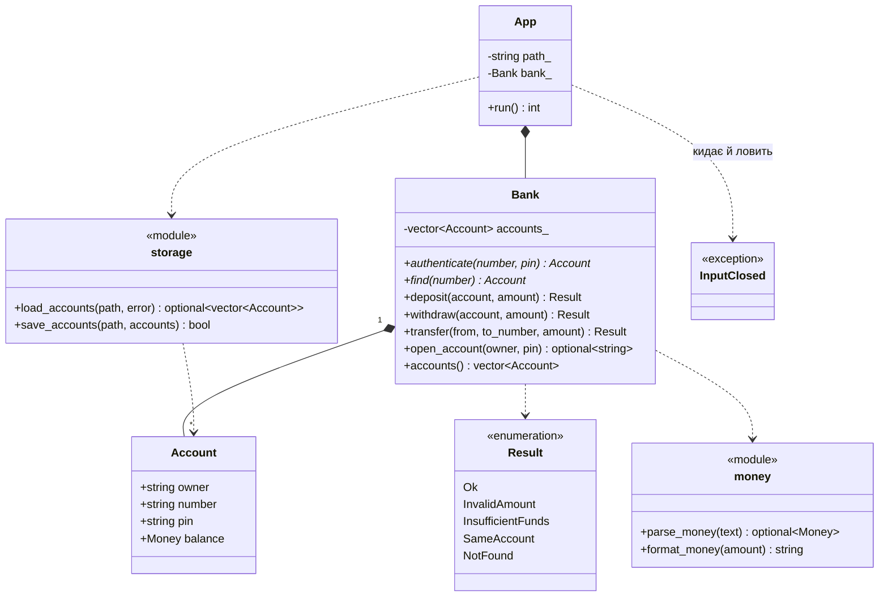

# Діаграма класів

`Money` — псевдонім `std::int64_t` (центи). `App` — клас у `main.cpp`, що веде діалог (модуль `cli`). `InputClosed` — виняток, яким `cli` завершує програму, коли ввід закрито (BUG-04).
