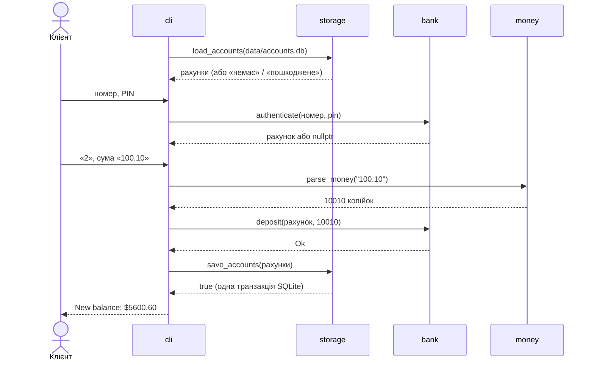
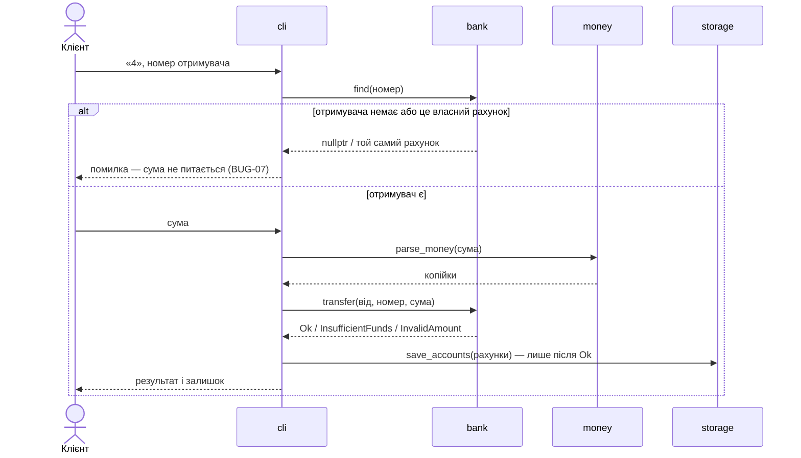

# План інтеграції

Знизу вгору: кожен крок перевіряється тестами без консолі.

| Крок | Що інтегруємо | Перевірка |
|---|---|---|
| 1 | `money` | TC-01…TC-05 |
| 2 | `bank` + `money` | TC-06…TC-22 |
| 3 | `storage` + структура рахунку | TC-23…TC-29 |
| 4 | `cli` + усі модулі | наскрізні сценарії TC-30…TC-37 |
| 5 | CI: збірка й тести на Ubuntu і Windows | зелений `ci.yml` |

## Послідовність: вхід і поповнення (UC-01, UC-02)

## Послідовність: переказ (UC-02)

## Стики й ризики

| Стик | Що може не зійтися | Як захищено |
|---|---|---|
| `cli` ↔ `money` | користувач вводить «12,50» з комою | `parse_money` відхиляє, `cli` просить ввести ще раз; кома — у беклозі як можлива зміна |
| `bank` ↔ `storage` | PIN «0123» збережеться як 123 | PIN — рядок у обох модулях; TC-23 перевіряє round-trip «0123» |
| `storage` ↔ `cli` | пошкоджене сховище перезапишеться демо-даними | `load_accounts` розрізняє «немає» і «пошкоджене»; `cli` при пошкодженні виходить з кодом 1 (TC-37) |
| `cli` ↔ `bank` | вказівник на рахунок «протух» після відкриття нового | `cli` шукає рахунок за номером на кожному кроці меню |
