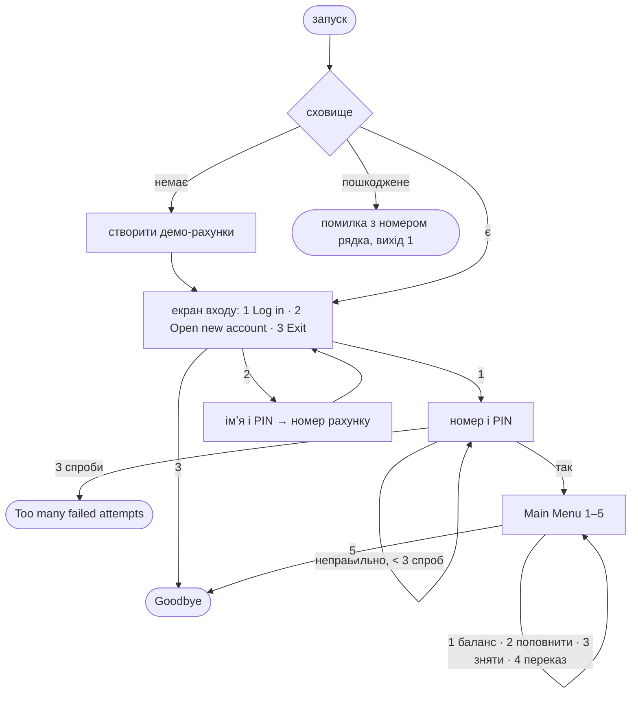
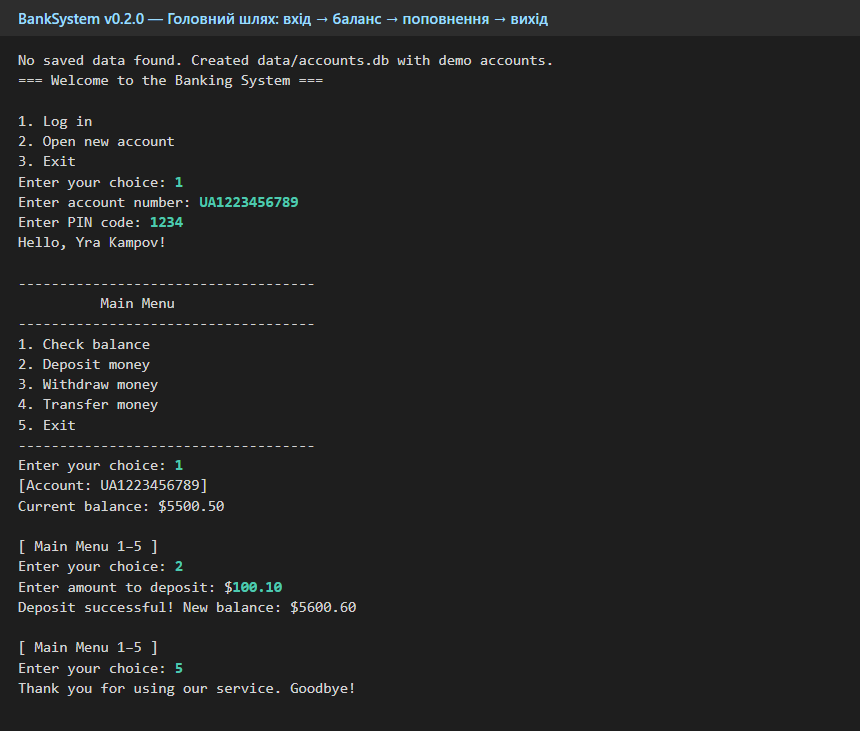
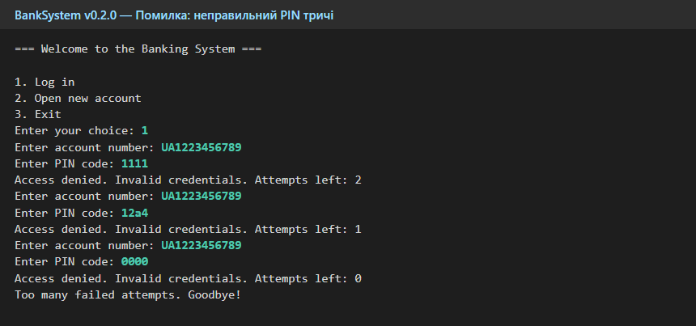
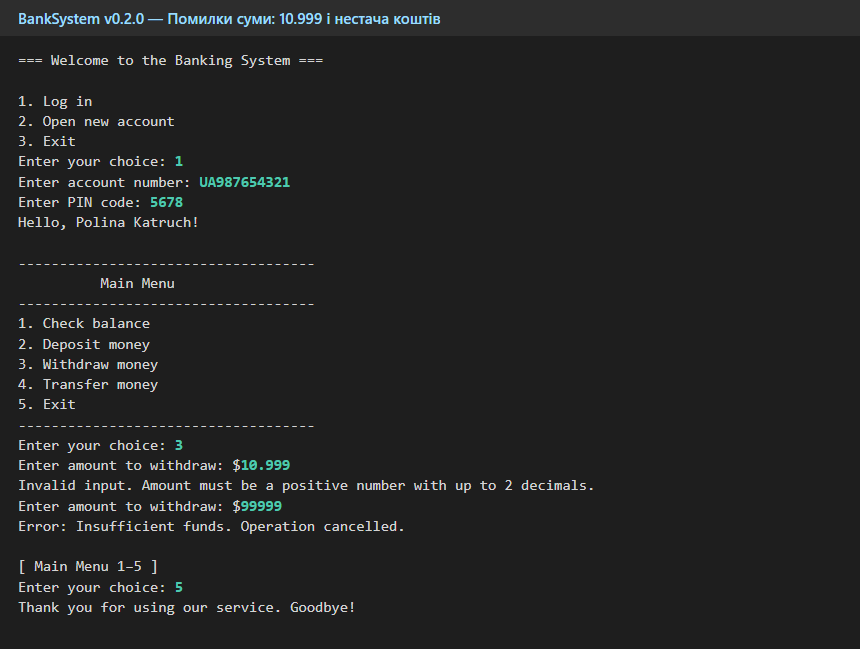
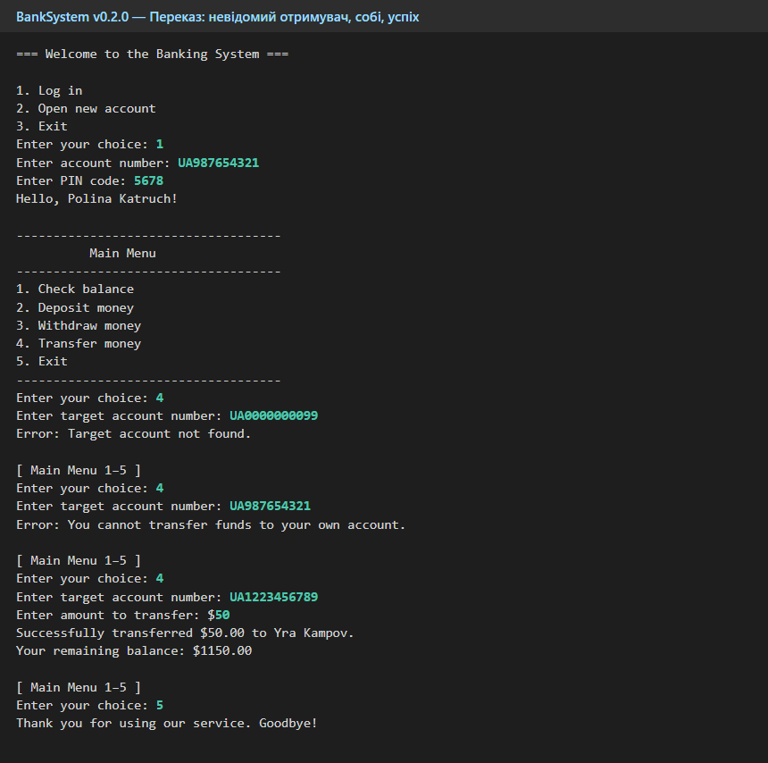
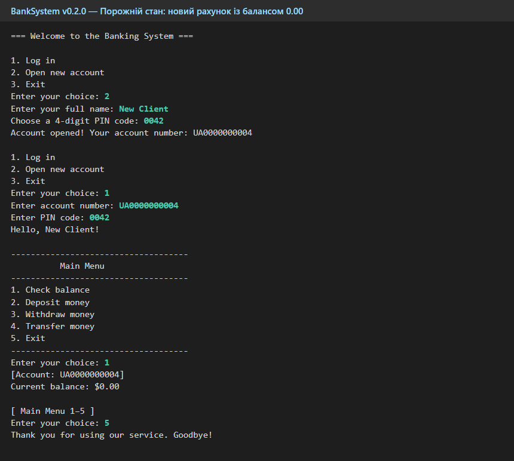
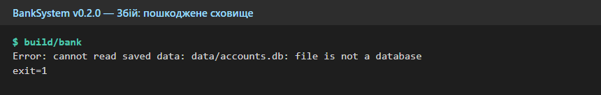

# Прототип головного шляху

> Автор: Юра Кампов, спеціальність F2 «Інженерія програмного забезпечення». 09.11.2026.

BankSystem консольний, тому прототип — це **сама програма v0.2.0**. Знімки нижче — справжній вивід `build/bank`, ввід користувача виділено кольором. Повторне головне меню скорочено до `[ Main Menu 1–5 ]`.

## Карта екранів



## Екрани

| # | Сценарій | Знімок | Що показує |
|---|---|---|---|
| 1 | Головний шлях |  | вхід, баланс 5500.50, поповнення на 100.10 → 5600.60 |
| 2 | Помилка входу |  | три неправильні PIN (`1111`, `12a4`, `0000`) — лічильник спроб і вихід |
| 3 | Помилки суми |  | `10.999` — повторний запит; 99999 при балансі 1200.00 — «Insufficient funds» |
| 4 | Переказ |  | невідомий отримувач і переказ собі — відмова **до** запиту суми; потім успішний переказ |
| 5 | Порожній стан |  | новий рахунок `UA0000000004` із балансом 0.00 |
| 6 | Збій сховища |  | пошкоджена база не перезаписується: причина помилки й код виходу 1 |

## Як повторити

```bash
printf '1\nUA1223456789\n1234\n1\n2\n100.10\n5\n' | build/bank tmp.db
```

Ввід для решти екранів — у [test-cases](../../4-quality/test-cases.md), TC-30…TC-37.
