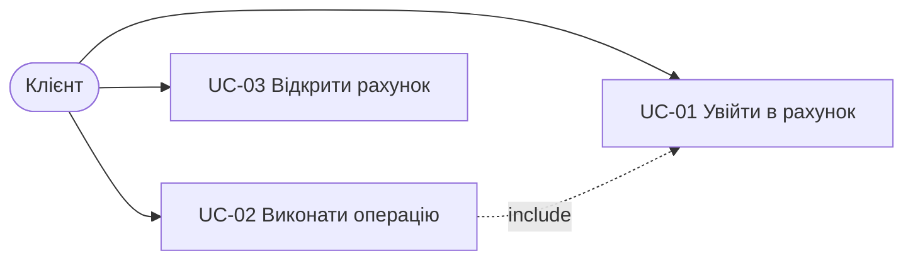

# Use cases

## UC-01. Увійти в рахунок

- **Актор:** клієнт. **Передумова:** програму запущено, сховище прочитано.
- **Основний потік:** 1) клієнт обирає «Log in»; 2) вводить номер рахунку; 3) вводить PIN; 4) система вітає «Hello, <імʼя>!» і показує меню.
- **Альтернативи:** 3а) номер чи PIN неправильні → «Access denied. Attempts left: N», повтор з кроку 2; 3б) третя невдала спроба → «Too many failed attempts», вихід; *) ввід закрито → «Input closed. Goodbye!», вихід.
- **Вимоги:** FR-01, FR-08.

## UC-02. Виконати операцію

- **Актор:** клієнт, що увійшов. **Передумова:** UC-01.
- **Основний потік:** 1) клієнт обирає пункт меню; 2) для поповнення, зняття й переказу вводить суму (і рахунок отримувача для переказу); 3) система виконує операцію, зберігає рахунки й показує новий баланс.
- **Альтернативи:** 2а) сума не число, ≤ 0 або більше 2 знаків після коми → повтор вводу; 3а) коштів недостатньо → «Insufficient funds», баланс без змін; 2б) отримувач — власний рахунок або не існує → помилка **до** запиту суми; 3б) зберегти не вдалось → попередження, операція в памʼяті лишається.
- **Постумова:** після перезапуску баланс той самий.
- **Вимоги:** FR-02…FR-06.

## UC-03. Відкрити рахунок

- **Актор:** новий клієнт.
- **Основний потік:** 1) на екрані входу обирає «Open new account»; 2) вводить імʼя; 3) вводить PIN із 4 цифр; 4) система видає номер `UA…` з нульовим балансом і зберігає.
- **Альтернативи:** 2а/3а) імʼя коротше 2 чи довше 50 символів, містить `;`, PIN не з 4 цифр → помилка, рахунок не створено.
- **Вимоги:** FR-07.
