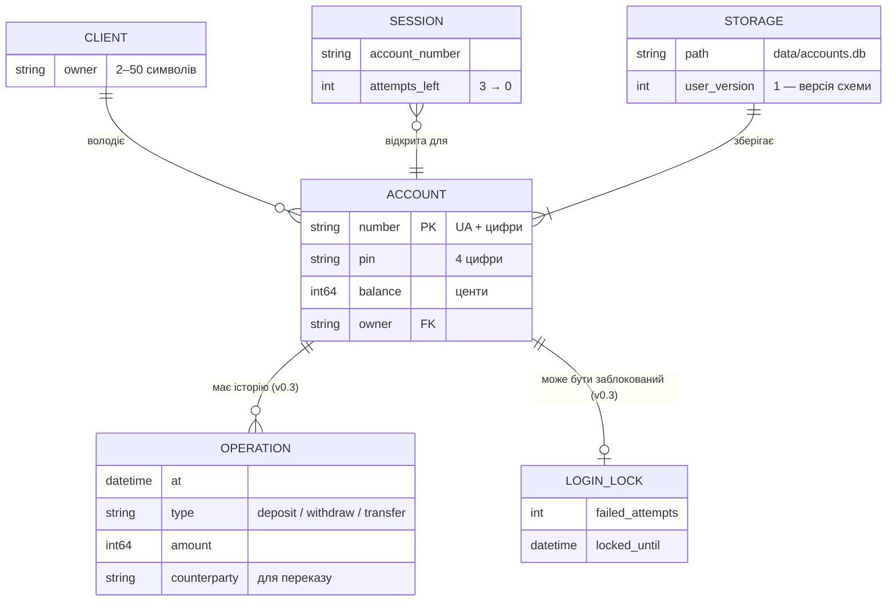

# Модель даних

## ER-діаграма

Зараз у сховищі живе одна сутність — «Рахунок»; власник записаний полем у ньому. Решта — у памʼяті або заплановані (позначено).



| Сутність | Де живе | Стан |
|---|---|---|
| Клієнт | поле `owner` у рахунку | ✅ v0.2 |
| Рахунок | таблиця `accounts` у `data/accounts.db` і памʼять | ✅ v0.2 |
| Сесія | лише памʼять `cli` (номер рахунку, спроби входу) | ✅ v0.2 |
| Сховище | база SQLite з версією схеми `user_version` | ✅ v0.2 |
| Операція | таблиця `operations` | план v0.3 (FR-09) |
| Блокування входу | — | план v0.3 (FR-10) |

База даних — **SQLite 3.50.4**, вбудована в програму: окремого сервера немає, усе в одному файлі `data/accounts.db` ([ADR-0004](../2-architecture/adr/0004-sqlite-storage.md)). Зовнішніх сервісів немає.

## Сутність «Рахунок»

| Поле | Тип у коді | Обовʼязкове | Приклад | Правило |
|---|---|---|---|---|
| `number` | `std::string` | так | `UA1223456789` | `UA` + цифри; унікальний |
| `pin` | `std::string` | так | `0123` | рівно 4 цифри; рядок, не число |
| `balance` | `Money` (`int64_t`, центи) | так | `550050` = 5500.50 | 0 … 99 999 999 999 |
| `owner` | `std::string` | так | `Yra Kampov` | 2–50 символів, без `;` і переносів рядка |

Нові рахунки отримують номер `UA` + 10 цифр (`UA0000000004`) — перший вільний, починаючи з кількості рахунків + 1.

## Схема бази `data/accounts.db`

```sql
CREATE TABLE accounts (
  number  TEXT PRIMARY KEY,                       -- UA + цифри
  pin     TEXT NOT NULL CHECK (length(pin) = 4 AND pin NOT GLOB '*[^0-9]*'),
  balance INTEGER NOT NULL CHECK (balance BETWEEN 0 AND 99999999999),  -- центи
  owner   TEXT NOT NULL
);
PRAGMA user_version = 1;  -- версія схеми
```

Демо-дані після першого запуску:

| number | pin | balance | owner |
|---|---|---|---|
| UA1223456789 | 1234 | 550050 | Yra Kampov |
| UA987654321 | 5678 | 120000 | Polina Katruch |
| UA1122334455 | 1111 | 340000 | Ivanka Katruch |

- **Запис:** одна транзакція — `BEGIN IMMEDIATE`, `DELETE`, `INSERT` кожного рахунку, `COMMIT`. Помилка → `ROLLBACK`, старі дані лишаються.
- **Читання:** база відкривається лише для читання; кожен рядок перевіряється ще раз у коді, бо базу могли змінити стороннім інструментом.
- **Перший запуск:** якщо файлу немає, читання його **не створює** — `cli` створює базу з демо-рахунками.
- **Як подивитись:** DB Browser for SQLite або `sqlite3 data/accounts.db "SELECT * FROM accounts;"`.

## Що лишається в памʼяті

Лише вектор рахунків у `Bank`. Історії операцій у v0.2 немає (FR-09 — v0.3).

## Зберігання й доступ

| Дані | Де | Хто має доступ |
|---|---|---|
| Рахунки, PIN, баланси | `data/accounts.db` на компʼютері, де запущено програму | будь-хто з доступом до цієї теки — PIN відкритим текстом ([privacy](../5-management/privacy.md)) |
| Те саме в git | **ніде**: `data/` у `.gitignore` | — |
