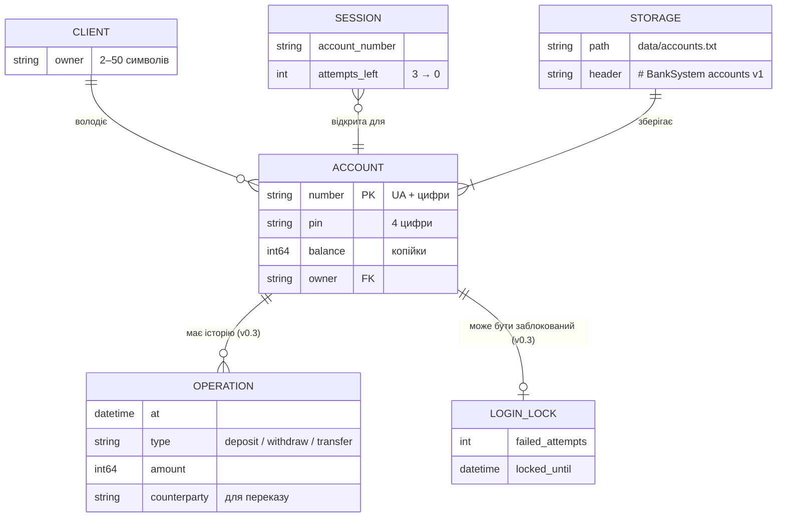

# Модель даних

## ER-діаграма

Зараз у сховищі живе одна сутність — «Рахунок»; власник записаний полем у ньому. Решта — у памʼяті або заплановані (позначено).



| Сутність | Де живе | Стан |
|---|---|---|
| Клієнт | поле `owner` у рахунку | ✅ v0.2 |
| Рахунок | `data/accounts.txt` і памʼять | ✅ v0.2 |
| Сесія | лише памʼять `cli` (номер рахунку, спроби входу) | ✅ v0.2 |
| Сховище | файл із заголовком версії формату | ✅ v0.2 |
| Операція | — | план v0.3 (FR-09) |
| Блокування входу | — | план v0.3 (FR-10) |

Зовнішніх сервісів і бази даних немає: усе в одному текстовому файлі ([ADR-0003](../2-architecture/adr/0003-text-file-storage.md)).

## Сутність «Рахунок»

| Поле | Тип у коді | Обовʼязкове | Приклад | Правило |
|---|---|---|---|---|
| `number` | `std::string` | так | `UA1223456789` | `UA` + цифри; унікальний |
| `pin` | `std::string` | так | `0123` | рівно 4 цифри; рядок, не число |
| `balance` | `Money` (`int64_t`, копійки) | так | `550050` = 5500.50 | 0 … 99 999 999 999 |
| `owner` | `std::string` | так | `Yra Kampov` | 2–50 символів, без `;` і переносів рядка |

Нові рахунки отримують номер `UA` + 10 цифр (`UA0000000004`) — перший вільний, починаючи з кількості рахунків + 1.

## Формат сховища `data/accounts.txt`

```text
# BankSystem accounts v1
UA1223456789;1234;550050;Yra Kampov
UA987654321;5678;120000;Polina Katruch
UA1122334455;1111;340000;Ivanka Katruch
```

- Рядки, що починаються з `#`, і порожні рядки пропускаються.
- Поля через `;` у порядку **номер; PIN; баланс у копійках; імʼя**. Імʼя останнє — може містити пробіли.
- Кодування — UTF-8; закінчення рядків `\n` (файл, збережений у Windows із `\r\n`, теж читається).
- Запис: спершу `accounts.txt.tmp`, потім заміна основного файлу ([ADR-0003](../2-architecture/adr/0003-text-file-storage.md)).

## Що лишається в памʼяті

Лише вектор рахунків у `Bank`. Історії операцій у v0.2 немає (FR-09 — v0.3).

## Зберігання й доступ

| Дані | Де | Хто має доступ |
|---|---|---|
| Рахунки, PIN, баланси | `data/accounts.txt` на компʼютері, де запущено програму | будь-хто з доступом до цієї теки — PIN відкритим текстом ([privacy](../5-management/privacy.md)) |
| Те саме в git | **ніде**: `data/` у `.gitignore` | — |
