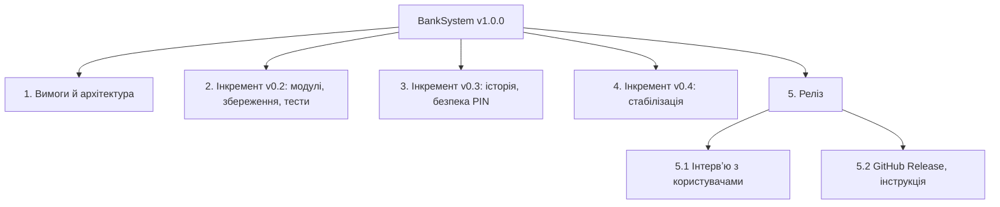
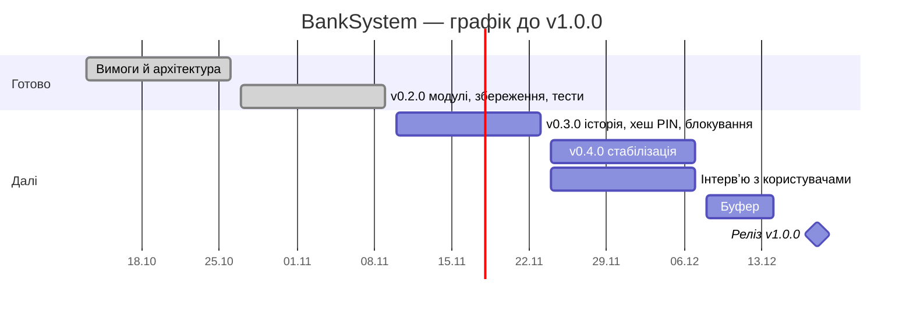

# План робіт

> Автор: Юра Кампов, спеціальність F2 «Інженерія програмного забезпечення».

## WBS

## Оцінка

| Пакет | SP | Стан |
|---|---|---|
| 1. Вимоги й архітектура | 3 | ✅ |
| 2. v0.2.0 (задачі 1–9 беклогу) | 17 | ✅ 09.11.2026 |
| 3. v0.3.0 (задачі 10–14) | 14 | 10.11–23.11 |
| 4. v0.4.0 (задача 15, виправлення) | 5 | 24.11–07.12 |
| 5. Реліз | 3 | до 18.12 |

## Графік

Дати завершених пакетів — орієнтовні: курс почався 13.10.2026, v0.2.0 готова 09.11.2026.

## Критичний шлях

Вимоги → модулі → збереження → тести й CI → історія операцій → хеш PIN → інтервʼю → реліз. Хеш PIN (задача 12) змінює формат сховища, тому йде до будь-яких змін формату для історії.

## Ризики плану

Один розробник — будь-яка хвороба чи сесія зсуває все ([risks](risks.md), R-01). Буфер — тиждень між v0.4.0 і релізом.
