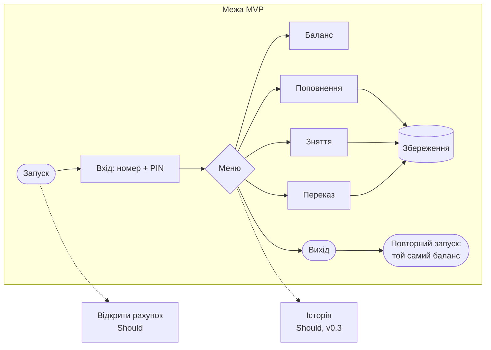

# Практична 2. Вимоги до власного продукту й межа MVP: BankSystem

**Автор:** Юра Кампов, спеціальність F2 «Інженерія програмного забезпечення» · **Дата:** 09.11.2026

Повний перелік вимог — [srs.md](../1-lifecycle/srs.md); тут — 10 ключових у формі user story.

## 1. Вимога чи побажання

Критерій: **до вимоги можна написати тест.**

| № | Формулювання | Вимога? | Переписано |
|---|---|---|---|
| 1 | «Застосунок має бути зручним» | ❌ «зручно» не виміряти | 4 з 5 нових користувачів без інструкції входять у рахунок і роблять переказ ≤ 5 хв |
| 2 | «Сторінка розкладу відкривається швидко» | ❌ «швидко» — скільки? | 95 % відкриттів — ≤ 2 с на мобільному інтернеті 4G |
| 3 | «Студент бачить свої пари на сьогодні» | ✅ є що перевірити | уточнення: після входу — пари на сьогодні з часом і аудиторією або «Сьогодні пар немає» |
| 4 | «Система має бути надійною» | ❌ немає числа | збій посеред запису не псує дані; доступність ≥ 99 % на місяць |
| 5 | «Викладач позначає відсутніх за один екран» | ✅ перевіряється проходом | уточнення: 30 студентів — без переходу на інші екрани, ≤ 1 хв |

**На власному продукті:**

| Формулювання | Що не так | Як переписано |
|---|---|---|
| «Програма рахує гроші правильно» | «правильно» — як перевірити? | «суми точні до цента: 0.30 − 0.10 − 0.20 = 0.00, жодних похибок округлення» (NFR-1) — тест TC-14 падав на v0.1.0 |
| «Програма записує дані користувачів» | не сказано, коли й що буде після перезапуску | «після кожної операції рахунки зберігаються; після перезапуску баланс той самий» (FR-06) |
| «PIN має бути безпечним» | побажання | «PIN — рівно 4 цифри; «0123» не пускає з «123»; ≤ 3 спроби» (FR-01, FR-08) |

## 2. User stories

### Функціональні

**US-01. Вхід.** Як клієнт, я хочу увійти за номером рахунку й PIN, щоб ніхто інший не керував моїми грошима.
Критерії приймання:

- правильні номер і PIN → «Hello, <імʼя>!» і меню;
- PIN порівнюється як рядок: для «0123» не підходять «123» і «0123x»;
- після 3 невдалих спроб — «Too many failed attempts», вихід.

**US-02. Баланс.** Як клієнт, я хочу бачити баланс, щоб знати, скільки можу витратити.
Критерії приймання:

- показано номер рахунку й баланс рівно з 2 знаками після коми.

**US-03. Поповнення.** Як клієнт, я хочу покласти гроші на рахунок.
Критерії приймання:

- сума > 0, до 2 знаків після коми (`100.50`);
- `0`, `abc`, `100abc`, `10.999` — «Invalid input» і повтор;
- показано новий баланс.

**US-04. Зняття.** Як клієнт, я хочу зняти гроші, якщо їх вистачає.
Критерії приймання:

- рівно весь баланс — можна, баланс 0.00;
- на 0.01 більше — «Insufficient funds», баланс без змін;
- 0.30 − 0.10 − 0.20 — обидва зняття успішні.

**US-05. Переказ.** Як клієнт, я хочу переказати гроші іншому клієнту за номером рахунку.
Критерії приймання:

- отримувач перевіряється **до** запиту суми: невідомий чи власний рахунок — помилка одразу;
- у відправника зменшилось, в отримувача збільшилось на ту саму суму.

**US-06. Збереження.** Як клієнт, я хочу, щоб мій баланс не зникав після виходу з програми.
Критерії приймання:

- після перезапуску баланс той самий;
- пошкоджене сховище не перезаписується: показано номер рядка з помилкою.

**US-07. Відкриття рахунку** — *розрізано на частини*. Як новий клієнт, я хочу відкрити рахунок.

- **US-07а (зараз):** імʼя 2–50 символів, PIN із 4 цифр → номер `UA…`, баланс 0.00.
- **US-07б (пізніше):** перевірка, що такий клієнт ще не має рахунку; підтвердження PIN двічі.

**US-08. Історія операцій.** Як клієнт, я хочу бачити останні операції, щоб перевірити, куди поділись гроші.
Критерії приймання:

- останні 10 операцій: дата, тип, сума, баланс після.

### Нефункціональні (ISO/IEC 25010)

**US-09. Стійкість до вводу.** Як клієнт, я не хочу, щоб програма зависла від мого вводу.
Критерії приймання:

- будь-який ввід (літери, порожній рядок) — повідомлення й повтор;
- кінець вводу (EOF) — вихід ≤ 1 с, а не нескінченний цикл.

**US-10. Переносимість.** Як одногрупник, я хочу зібрати програму на своїй ОС однією командою.
Критерії приймання:

- `cmake -S . -B build && cmake --build build` без попереджень на Windows і Linux;
- CI зелений на обох ОС.

## 3. MoSCoW

| Must | Should | Could | Won't |
|---|---|---|---|
| US-01 Вхід | US-07а Відкриття рахунку | US-07б Перевірка дублікатів клієнта | Кілька валют |
| US-02 Баланс | US-08 Історія операцій | | Мережа, кілька клієнтів одночасно |
| US-03 Поповнення | US-10 Переносимість | | |
| US-04 Зняття | | | |
| US-05 Переказ | | | |
| US-06 Збереження | | | |
| US-09 Стійкість до вводу | | | |

**Що станеться без кожного Must:** без US-01 — будь-хто в чужому рахунку; без US-02…US-05 — немає банку; без US-06 — дані зникають після виходу (у v0.1.0 так і було); без US-09 — одна помилка вводу вішає програму (у v0.1.0 — 97 МБ виводу за 3 с).

**Розрізано:** відкриття рахунку не відкладено цілком — базова частина (07а) у Should і вже зроблена, а складніша (07б) — у Could.

## 4. Наскрізний шлях і межа MVP

**Перевірка межі:**

1. **Користувач проходить шлях сам?** Так: демо-рахунки й PIN — у README, меню з номерами пунктів.
2. **Можна викинути ще крок?** Ні: без входу немає захисту, без збереження шлях «повернутися й побачити ту саму суму» обривається.
3. **Немає «бо все одно робимо»?** Відкриття рахунку зроблено, але свідомо **поза** межею MVP: шлях проходить і на демо-рахунках.

**Чому межа саме тут:** мінімум, за який банку можна довіряти, — увійти, зробити операцію, вийти й повернутися до тієї самої суми. Усе, що робить банк зручнішим (відкриття рахунку, історія), — за межею.
